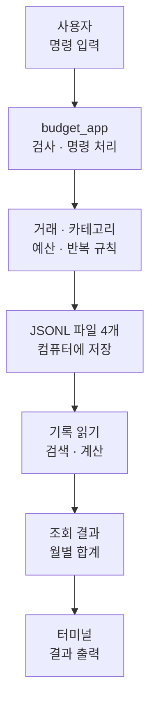
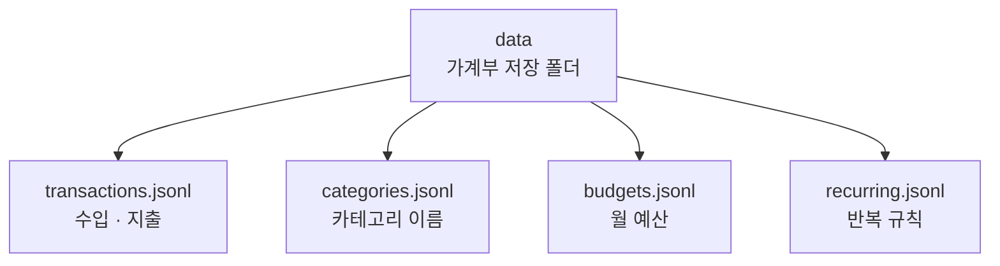
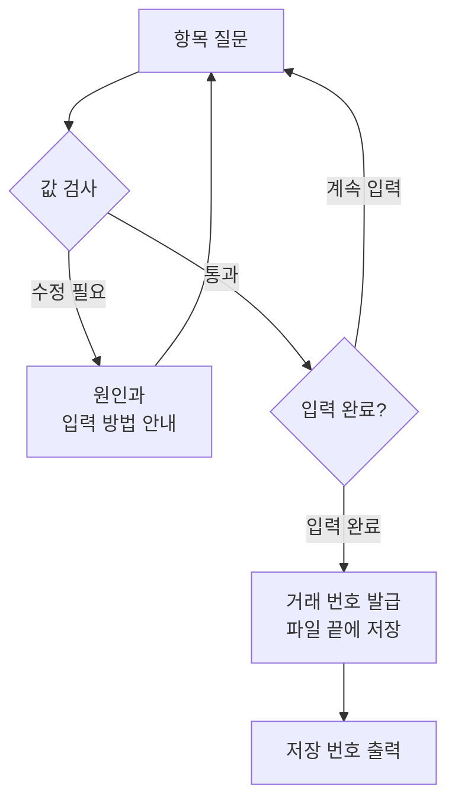
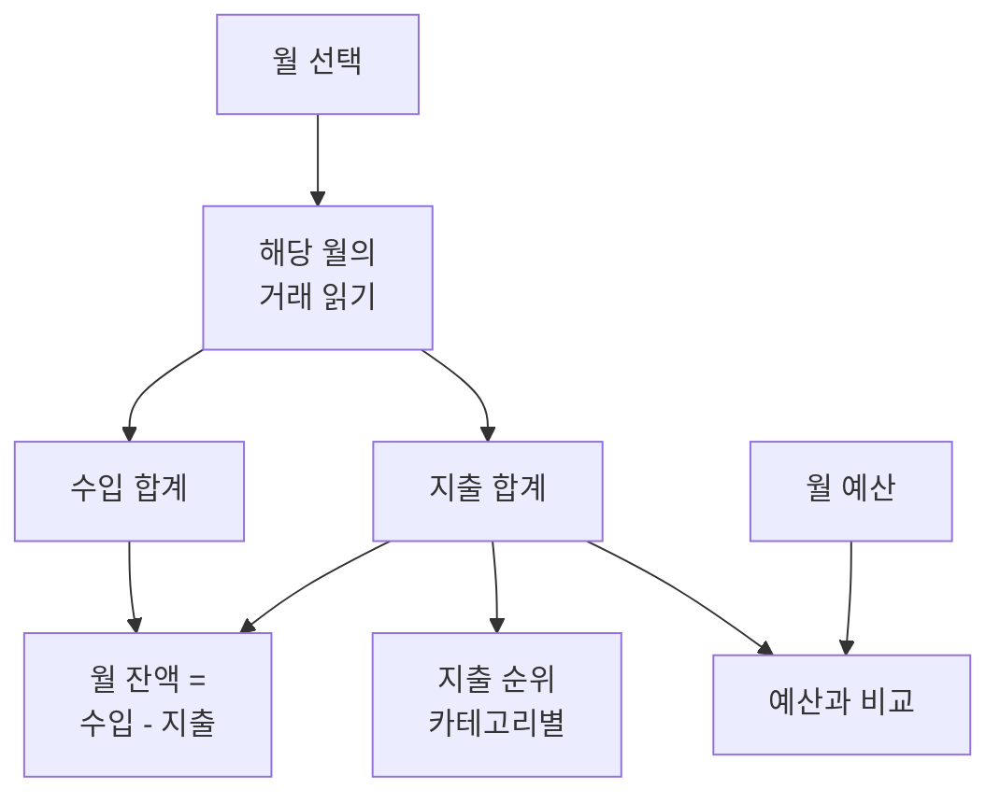
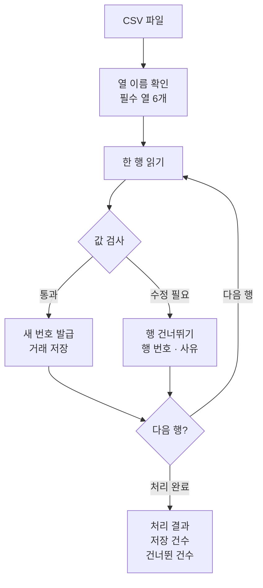
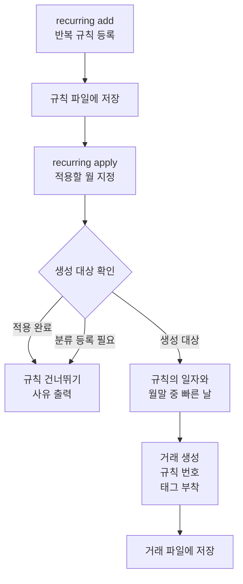
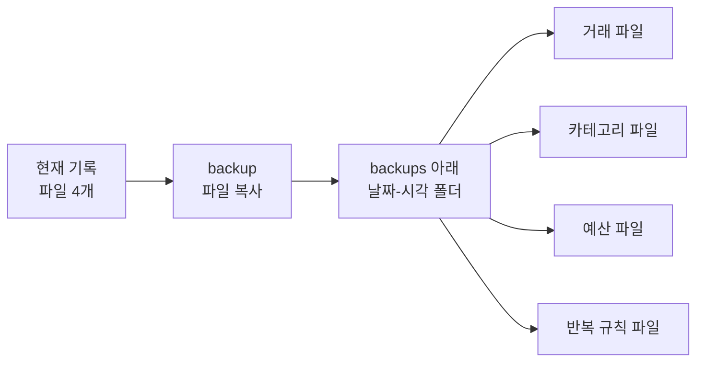
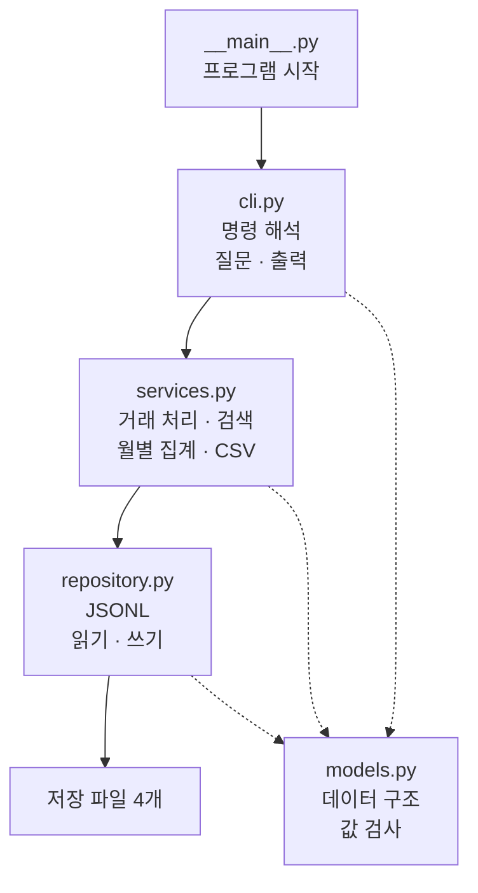
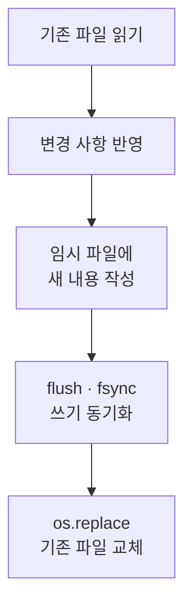

# budget_app · 나만의 용돈 기입장

**수입과 지출을 기록하고, 필요한 내역을 찾고, 한 달의 돈 흐름을 계산하는 터미널 가계부입니다.** 터미널은 글자로 명령을 입력하고 결과를 읽는 화면입니다. 사용자는 명령으로 할 일을 정하고, 프로그램은 내 컴퓨터의 파일에 기록을 저장합니다.

Python 3.10 이상에서 실행하며, Python 기본 기능인 **표준 라이브러리**로 구성했습니다. Codyssey Mission B2-1 과제로 만든 프로그램입니다.

## 1. 가계부의 전체 모습

### 1.1. 명령을 입력하면 기록을 읽고 결과를 보여줍니다

가계부의 중심은 거래 한 건입니다. 수입도 한 건, 지출도 한 건으로 저장합니다. 프로그램은 이 거래들을 모아 최근 내역, 검색 결과, 월별 합계를 만듭니다. 예산은 지출을 비교할 기준이고, 반복 규칙은 매달 같은 내용의 거래를 만드는 재료입니다.



### 1.2. 명령 하나가 할 일 하나를 맡습니다

| 할 일 | 명령 |
| --- | --- |
| 수입·지출 한 건 기록 | `add` |
| 최근 거래 조회 | `list` |
| 날짜·카테고리·메모·태그로 검색 | `search` |
| 월별 수입·지출·잔액 계산 | `summary` |
| 월 예산 설정과 조회 | `budget set`, `budget list` |
| 카테고리 추가·조회·삭제 | `category add`, `category list`, `category remove` |
| 거래 수정 | `update` |
| 거래 삭제 | `delete` |
| CSV에서 거래 가져오기 | `import` |
| 거래를 CSV로 내보내기 | `export` |
| 저장 파일의 복사본 만들기 | `backup` |
| 매달 반복할 거래의 규칙 관리와 적용 | `recurring add`, `recurring list`, `recurring remove`, `recurring apply` |

`income`은 수입, `expense`는 지출입니다. 두 종류 모두 금액을 양수로 적습니다. 프로그램은 수입·지출 구분을 보고 합산할 위치를 정합니다.

### 1.3. 과제 요구사항과 구현 위치

R01~R25는 필수 요구사항의 번호이고, B1~B4는 선택 과제의 번호입니다. 각 번호는 과제 내용과 구현 위치를 연결합니다.

<details>
<summary>요구사항 29개와 구현 위치 펼치기</summary>

| 번호 | 구현한 내용 | 담당 위치 |
| --- | --- | --- |
| R01 | `python -m budget_app`으로 실행 | `__main__.py` |
| R02 | 명령별 `--help` 제공 | `cli.py` |
| R03 | `--`로 시작하는 옵션 사용 | `cli.py` |
| R04 | 거래 항목을 데이터 클래스로 정의 | `models.py` |
| R05 | 클래스 2개 이상 사용 | 모델·저장소·서비스 |
| R06 | 날짜·금액·종류·카테고리 검사 | `models.py`, `services.py` |
| R07 | JSONL 저장 형식 선택 | `repository.py` |
| R08 | 저장 파일 4개 사용 | 거래·카테고리·예산·반복 규칙 |
| R09 | 저장 폴더 지정 | `--data-dir` |
| R10 | 첫 실행에서 파일과 기본 카테고리 준비 | `ensure_initialized` |
| R11 | 질문에 답하며 거래 추가 | `add` |
| R12 | 최신순 조회와 출력 건수 지정 | `list` |
| R13 | 거래 번호로 삭제 | `delete` |
| R14 | 옵션으로 수정할 값 지정 | `update` |
| R15 | 수정·삭제 시 임시 파일을 완성하고 교체 | `JsonlStore.rewrite` |
| R16 | 여러 조건을 결합한 검색 | `search` |
| R17 | 월별 합계와 카테고리별 지출 순위 | `summary` |
| R18 | 월 예산 저장과 초과 금액 표시 | `budget`, `summary` |
| R19 | 카테고리 관리와 거래의 분류 이동 | `category` |
| R20 | CSV 가져오기와 내보내기 | `import`, `export` |
| R21 | 오류·로그·시간 측정 데코레이터 적용 | `decorators.py` |
| R22 | 오류 설명과 종료 코드 제공 | `errors.py`, `decorators.py`, `cli.py` |
| R23 | 역할에 따라 모듈 분리 | `budget_app/` |
| R24 | 실행·저장·명령·CSV 사용법 작성 | `README.md` |
| R25 | 프로그램과 검증에 표준 라이브러리 사용 | `budget_app/`, `tests/`, `scripts/` |
| B1 | 저장 파일 백업 | `backup` |
| B2 | 반복 규칙의 등록과 월별 적용 | `recurring` |
| B3 | 한글 너비를 반영한 출력 열 정렬 | `formatting.py` |
| B4 | 완성한 임시 파일로 원본 교체 | `JsonlStore.rewrite` |

</details>

## 2. 프로그램 시작하기

Python 3.10 이상과 Git을 준비한 뒤 저장소를 내려받습니다.

```powershell
git clone https://github.com/Cerhovah/Codyssey_Mission_B2-1.git
cd Codyssey_Mission_B2-1
python --version
python -m budget_app --help
```

명령을 실행할 위치는 `budget_app` 폴더가 들어 있는 저장소의 최상위 폴더입니다. `python -m budget_app`은 Python에게 이 가계부를 실행하라는 뜻입니다. 그 뒤에 할 일과 세부 조건을 붙입니다.

```text
python -m budget_app 명령 옵션
```

`--help`는 사용법을 보여줍니다. 명령 뒤에 붙이면 그 명령의 옵션을 설명합니다.

```powershell
python -m budget_app search --help
```

기본 저장 폴더는 명령을 실행한 위치의 `data`입니다. `--data-dir`로 폴더를 정하면 해당 폴더의 가계부를 사용합니다. **`--data-dir`와 `--verbose`는 명령 앞에 적어야 합니다.**

```powershell
python -m budget_app --data-dir ./my_data list
```

이 명령은 `my_data` 폴더의 거래 목록을 조회합니다. 일반 기능 명령을 처음 실행하면 프로그램이 저장 폴더와 파일 4개를 만들고 초기화 안내를 출력합니다. 도움말과 명령 형식 검사는 저장소 준비 단계에 앞서 처리합니다.

## 3. 기록이 파일에 저장되는 모습

### 3.1. 파일마다 담는 내용이 정해져 있습니다

JSONL은 **한 줄에 데이터 한 건을 적는 텍스트 파일 형식**입니다. 거래 한 건은 거래 파일의 한 줄을 차지합니다. 프로그램은 한글을 UTF-8로 저장합니다.



처음 준비하는 카테고리는 `food`, `transport`, `rent`, `salary`, `etc`입니다. 각각 식비, 교통비, 임차료, 급여, 기타의 뜻입니다. 카테고리 파일이 빈 상태일 때 이 다섯 이름을 채웁니다.

저장 폴더 하나의 쓰기 작업은 한 프로그램에서 차례대로 진행해야 합니다.

### 3.2. 거래 한 건은 일곱 항목으로 구성됩니다

```json
{"id":"TX-000001","type":"expense","date":"2026-10-18","amount":5000,"category":"food","memo":"점심","tags":["meal"]}
```

| 항목 | 뜻 | 위 기록의 값 |
| --- | --- | --- |
| `id` | 수정·삭제할 거래를 찾는 번호 | `TX-000001` |
| `type` | 수입·지출 구분 | `expense`: 지출 |
| `date` | 거래 날짜 | `2026-10-18` |
| `amount` | 금액 | `5000` |
| `category` | 돈의 용도를 나누는 분류 | `food` |
| `memo` | 거래 설명 | `점심` |
| `tags` | 검색할 때 쓰는 꼬리표 | `meal` |

거래 번호는 `TX-`, 반복 규칙 번호는 `RC-`로 시작합니다. 프로그램은 해당 파일에 저장된 번호 중 가장 큰 숫자에 1을 더해 새 번호를 정합니다. 가장 큰 번호를 삭제한 뒤 새 항목을 추가하면 그 번호를 다시 발급합니다.

## 4. 거래를 기록하고 찾아보기

각 명령 예시는 해당 기능의 사용 형태를 보여줍니다. 수정·삭제 명령의 거래 번호는 실제 `list` 결과에서 골라야 합니다.

### 4.1. add: 질문에 답하면 거래가 저장됩니다

```text
python -m budget_app add
날짜(YYYY-MM-DD): 2026-10-18
타입(income/expense): expense
카테고리: food
금액(양수 정수): 5000
메모(선택): 점심
태그(쉼표로 구분, 없으면 엔터): meal
[저장 완료] id=TX-000001
```

프로그램은 날짜, 수입·지출 구분, 카테고리, 금액, 메모, 태그를 차례로 묻습니다. 입력값을 검사하고 질문을 마친 뒤 거래 파일 끝에 한 줄을 추가합니다.

날짜는 `2026-10-18`처럼 연도 네 자리, 월 두 자리, 일 두 자리로 적어야 합니다. 실제 달력에 있는 날짜를 입력해야 합니다. 금액은 `5000`처럼 **0보다 큰 정수**로 적어야 합니다. 카테고리는 등록된 이름을 사용해야 합니다. 수입·지출 구분은 앞뒤 공백과 영문 대소문자를 정리해 처리합니다.

메모와 태그는 선택 항목입니다. 빈 값은 엔터로 입력합니다. 태그 여러 개는 쉼표로 나눕니다. 프로그램은 각 태그의 앞뒤 공백을 정리하고, 빈 항목과 중복 태그를 제거합니다.



입력 오류가 생기면 프로그램이 같은 항목을 다시 묻습니다. 질문 도중 Ctrl+C를 누르거나 입력을 종료하면 프로그램은 종료 코드 130으로 끝납니다.

### 4.2. list: 최근 거래부터 보여줍니다

```powershell
python -m budget_app list --limit 3
```

거래 날짜가 늦은 순서로 최대 3건을 출력합니다. 같은 날짜의 거래는 거래 번호 문자열의 역순으로 정렬합니다. `--limit`의 기본값은 20이며, 건수는 양의 정수로 지정해야 합니다.

목록의 열은 `번호 | 날짜 | 수입·지출 구분 | 카테고리 | 금액 | 메모`입니다. 태그는 `search --tag`의 검색 기준으로 사용합니다. 거래가 0건이면 조회 결과를 안내합니다.

### 4.3. search: 여러 조건을 한꺼번에 적용합니다

```powershell
python -m budget_app search --category food --q 점심 --limit 10
```

프로그램은 카테고리가 `food`이고 메모에 `점심`이 들어 있는 거래를 골라 최대 10건을 보여줍니다. 여러 조건을 붙이면 **모든 조건을 만족하는 거래**를 찾습니다.

| 옵션 | 검색 기준 |
| --- | --- |
| `--from YYYY-MM-DD` | 이 날짜부터 포함 |
| `--to YYYY-MM-DD` | 이 날짜까지 포함 |
| `--category NAME` | 카테고리 이름의 정확한 일치 |
| `--type income` 또는 `--type expense` | 수입 또는 지출 |
| `--q TEXT` | 메모에 포함된 글자. 영문은 소문자로 맞춰 비교 |
| `--tag TAG` | 태그 하나의 정확한 일치 |
| `--limit N` | 최대 출력 건수 |

카테고리와 태그는 영문 대소문자를 구분합니다. 검색 결과도 최신순으로 출력합니다. `--limit`을 생략하면 조건에 맞는 전체 결과를 출력합니다. 결과가 0건이면 안내를 출력하고 종료 코드 0으로 끝납니다.

### 4.4. update와 delete: 거래 번호로 대상을 정합니다

```powershell
python -m budget_app update --id TX-000001 --amount 6000
```

프로그램은 `TX-000001`을 찾아 금액을 `6000`으로 바꿉니다. 수정할 값은 옵션으로 직접 적습니다. `--date`, `--type`, `--category`, `--amount`, `--memo`, `--tags` 중 하나 이상을 지정해야 합니다. 선택한 항목에 새 값을 넣고 나머지 항목은 기존 값을 사용합니다. 메모와 태그는 빈 문자열을 값으로 전달하면 비웁니다. 이때 사용하는 셸의 빈 인자 전달 문법을 따라야 합니다.

```powershell
python -m budget_app delete --id TX-000001
```

삭제 명령은 지정한 번호의 거래 한 건을 지웁니다. 수정과 삭제 모두 등록된 거래 번호를 지정해야 합니다. 대상 거래 확인과 입력 검사를 마친 뒤 파일을 재작성합니다.

## 5. 한 달의 돈 흐름과 분류 관리

### 5.1. summary: 수입·지출·잔액을 계산합니다

```powershell
python -m budget_app summary --month 2026-10 --top 3
```

프로그램은 `2026-10`에 해당하는 거래를 골라 수입과 지출을 각각 더합니다. **월 잔액은 선택한 달의 수입 합계에서 지출 합계를 뺀 값**입니다. 수입 10000원, 지출 3000원이면 그달의 잔액은 7000원입니다.



`--top 3`은 지출이 큰 카테고리 3개를 뜻합니다. 기본값은 5개이며, 양의 정수로 지정해야 합니다. 지출 금액이 같으면 카테고리 이름순으로 나열합니다. 거래가 0건인 달은 `데이터 없음`으로 표시합니다.

### 5.2. budget: 한 달의 지출 기준을 정합니다

```powershell
python -m budget_app budget set --month 2026-10 --amount 100000
python -m budget_app budget list
```

첫 명령은 2026년 10월의 지출 예산을 100000원으로 정합니다. 같은 달에 예산을 다시 설정하면 새 금액으로 바꿉니다. 예산 목록은 월이 빠른 순서로 보여줍니다.

월별 요약은 예산 사용률을 `지출 합계 ÷ 월 예산 × 100`으로 계산해 소수점 한 자리까지 표시합니다. 지출이 예산을 넘으면 초과 금액을 경고합니다. 예산 초과 지출도 거래에 등록하고, 월별 요약에 반영합니다.

### 5.3. category: 돈의 용도를 이름으로 나눕니다

```powershell
python -m budget_app category add cafe
python -m budget_app category list
python -m budget_app category remove --name cafe --replace etc
```

카테고리를 추가할 때는 새로운 이름을 사용해야 합니다. 이름을 생략하면 프로그램이 질문으로 받습니다. 이름의 앞뒤 공백을 정리하고 영문 대소문자를 구분하므로 `food`와 `Food`는 각각 별도의 카테고리입니다.

거래에서 사용 중인 카테고리를 지울 때는 `--replace`로 대체 카테고리를 함께 지정해야 합니다. 위 삭제 명령은 `cafe` 거래의 분류를 등록된 `etc`로 옮긴 뒤 `cafe`를 지웁니다. 사용한 거래가 0건인 카테고리는 `--name`으로 삭제합니다.

이 분류 이동은 거래 파일을 대상으로 합니다. 반복 규칙은 등록 당시의 카테고리 이름을 사용합니다. 카테고리를 삭제한 뒤 그 이름을 사용하는 반복 규칙을 적용하면, 프로그램은 해당 규칙을 건너뛰고 사유를 출력합니다.

## 6. CSV로 거래 주고받기

CSV는 행과 열로 구성된 표 파일입니다. 첫 줄에는 열 이름을 적고, 다음 줄부터 거래를 한 건씩 적습니다. 프로그램은 CSV의 거래를 읽어 JSONL에 저장하고, JSONL의 거래를 골라 CSV로 작성합니다.

### 6.1. 첫 줄에는 여섯 열 이름을 적어야 합니다

```csv
date,type,category,amount,memo,tags
2026-10-18,expense,food,5000,점심,meal
```

| 열 이름 | 적을 내용 | 값 입력 |
| --- | --- | --- |
| `date` | `YYYY-MM-DD` 형식의 실제 날짜 | 필수 |
| `type` | `income` 또는 `expense` | 필수 |
| `category` | 등록된 카테고리 이름 | 필수 |
| `amount` | 0보다 큰 정수 | 필수 |
| `memo` | 거래 설명 | 선택 |
| `tags` | 쉼표로 구분한 태그 | 선택 |

**여섯 열 이름을 모두 작성해야 합니다.** `memo`와 `tags`의 선택 입력은 해당 칸을 빈 값으로 작성한다는 뜻입니다. 태그 여러 개는 `"meal,daily"`처럼 따옴표로 감싸 한 칸에 넣습니다. 쉼표나 줄바꿈을 담은 메모도 CSV의 따옴표 규칙으로 작성해야 합니다.

가져오기는 UTF-8과 UTF-8 BOM 형식을 읽습니다. BOM은 파일 맨 앞에 붙는 인코딩 표식입니다. 프로그램은 열 이름으로 값을 찾으므로 여섯 열의 순서를 바꿔 작성해도 같은 항목으로 읽습니다. 추가 열은 처리 대상 여섯 열에서 제외합니다.

내보내기는 `date,type,category,amount,memo,tags` 순서로 작성하며, UTF-8 텍스트의 첫 줄을 헤더로 시작합니다. 거래 번호 `id`는 가져오는 과정에서 새로 발급합니다.

### 6.2. import: 행마다 검사하고 차례대로 저장합니다

```powershell
python -m budget_app import --from samples/import_sample.csv
```

프로그램은 파일을 한 행씩 읽고 날짜·금액·종류·카테고리를 검사합니다. 검사를 통과한 행은 새 거래 번호를 붙여 저장합니다. 입력 오류가 있는 행은 건너뛰고 행 번호와 이유를 보여줍니다. 최종 결과의 `imported`는 저장 건수이고, `skipped`는 건너뛴 건수입니다.



저장소에 포함된 샘플은 정상 행 5개와 금액 오류 행 1개로 구성되어, 기본 카테고리가 준비된 저장소에서 `imported=5, skipped=1`로 처리됩니다. 같은 CSV를 다시 가져오면 각 정상 행을 새 거래로 추가합니다.

가져오기는 행마다 저장을 완료합니다. 처리 도중 파일 오류가 발생하면 그 시점까지 완료한 행이 저장 결과에 반영됩니다. 행별 입력 오류를 건너뛰며 파일 처리를 마친 명령의 종료 코드는 0입니다. 처리 결과는 `imported`, `skipped`, 행별 사유를 함께 읽어 확인해야 합니다.

### 6.3. export: 기간에 맞는 거래를 표로 만듭니다

```powershell
python -m budget_app export --out october.csv --month 2026-10
```

프로그램은 2026년 10월 거래를 최신순으로 정렬한 뒤 `october.csv`에 기록합니다. 출력 파일은 쓰기 모드로 열어 헤더부터 작성합니다. 같은 이름의 파일을 지정하면 새 내용으로 바꿉니다. 출력할 폴더는 명령 실행 전에 준비해야 합니다.

기간은 `--month`, `--from`, `--to` 중 하나 이상으로 지정해야 합니다. `--from`만 지정하면 그 날짜 이후를 포함하고, `--to`만 지정하면 그 날짜까지 포함합니다. 월과 날짜 범위를 함께 적으면 모든 조건을 만족하는 거래를 내보냅니다. 일치하는 거래가 0건이면 여섯 열의 헤더를 작성합니다.

## 7. 반복 내역과 백업

### 7.1. recurring: 규칙을 등록하고 원하는 달에 적용합니다

월세처럼 매달 같은 내용으로 기록할 거래는 반복 규칙으로 등록합니다.

```powershell
python -m budget_app recurring add
```

프로그램은 매월 며칠에 기록할지, 수입인지 지출인지, 카테고리·금액·메모·태그를 무엇으로 정할지 묻습니다. 일자는 1~31로 입력해야 합니다. 질문을 마치면 `RC-000001` 같은 번호로 규칙을 저장합니다.

```powershell
python -m budget_app recurring list
python -m budget_app recurring apply --month 2026-10
python -m budget_app recurring remove --id RC-000001
```

`list`는 등록한 규칙을 보여줍니다. `apply`는 **지정한 달의 실제 거래를 생성하는 명령**입니다. 사용자가 `apply`를 실행할 때 프로그램이 각 규칙을 읽고 거래 파일에 추가합니다. `remove`는 지정한 규칙을 삭제합니다.



31일 규칙을 30일까지 있는 달에 적용하면 거래 날짜를 30일로 정합니다. 생성한 거래에는 `rc:RC-000001`처럼 규칙 번호를 담은 태그를 붙입니다. 프로그램은 해당 월의 거래 날짜와 이 태그를 읽어 적용 여부를 판정합니다. 같은 달에 같은 규칙 번호의 표식을 찾으면 그 규칙을 건너뜁니다. `created`는 만든 거래 수이고, `skipped`는 건너뛴 규칙 수입니다.

규칙 삭제는 반복 규칙 파일을 바꾸고, 생성된 거래의 수정·삭제는 거래 명령으로 처리합니다. 생성 거래의 날짜·표식 태그를 바꾸거나 거래를 삭제하면 다음 적용 때 사용하는 판정 자료도 바뀝니다. 새 규칙이 삭제된 규칙의 번호를 이어받으면, 프로그램은 해당 월의 기존 거래에 붙은 같은 번호의 표식을 보고 적용 완료로 처리합니다.

### 7.2. backup: 저장 파일 네 개를 한 폴더에 복사합니다

```powershell
python -m budget_app backup
```

프로그램은 `data/backups/날짜-시각/` 폴더를 만들고 현재 저장 파일 네 개를 복사합니다. `--data-dir`로 저장 위치를 정했다면 그 폴더 아래에 백업을 만듭니다. 같은 이름의 백업 폴더가 있으면 `-1`, `-2`를 붙여 새 폴더를 만듭니다.



복구는 프로그램을 종료한 뒤 백업 폴더의 필요한 JSONL 파일을 가계부 저장 폴더에 복사하는 절차로 진행합니다. 네 파일을 함께 복사하면 거래·카테고리·예산·반복 규칙을 그 백업의 내용으로 맞춥니다.

## 8. 코드가 일을 나누는 방식

### 8.1. 명령 해석, 계산, 파일 처리가 차례로 이어집니다

사용자가 명령을 입력하면 `cli.py`가 명령과 옵션을 해석합니다. `services.py`는 검색과 합계 계산 같은 업무를 처리합니다. `repository.py`는 필요한 파일을 읽고 씁니다. 데이터의 모양과 값 검사는 `models.py`가 담당합니다.



모듈은 역할을 나눈 Python 파일입니다. 이 구조에서는 명령을 해석하는 부분, 업무를 계산하는 부분, 파일을 다루는 부분의 담당자가 정해집니다.

| 파일·폴더 | 맡은 일 |
| --- | --- |
| `budget_app/__main__.py` | 프로그램 시작과 종료 코드 전달 |
| `budget_app/cli.py` | 명령 해석, 질문, 결과 출력 |
| `budget_app/services.py` | 거래·예산·반복 규칙 처리와 CSV 교환 |
| `budget_app/repository.py` | JSONL 읽기·추가·재작성, 초기화와 백업 복사 |
| `budget_app/models.py` | 거래·카테고리·예산·반복 규칙의 구조와 검사 함수 |
| `budget_app/decorators.py` | 오류 처리·호출 로그·시간 측정 |
| `budget_app/errors.py` | 오류의 종류와 종료 코드 |
| `budget_app/formatting.py` | 금액 표시와 한글 너비를 반영한 표 정렬 |
| `tests/` | 모델·저장소·서비스·명령 실행 테스트 |
| `scripts/verify.py` | 전체 검증 실행 |

### 8.2. 한 줄씩 읽고 필요한 결과를 고릅니다

저장소의 읽기 함수는 **제너레이터**입니다. 제너레이터는 요청을 받을 때 다음 데이터를 하나씩 건네는 방식입니다. 프로그램은 파일의 거래를 한 건씩 받아 검사하거나 계산합니다.

`list --limit N`은 파일을 끝까지 읽으며 최신 거래 N건을 후보로 유지합니다. `search --limit N`도 조건을 통과한 거래 중 N건을 고릅니다. 건수 제한을 생략한 검색과 CSV 내보내기는 조건에 맞는 결과를 모아 정렬하므로 결과 수에 따라 메모리 사용량이 늘어납니다. 월별 요약은 거래를 한 번 훑으며 합계를 누적합니다.

### 8.3. 수정·삭제는 새 파일을 완성한 뒤 교체합니다

거래 추가는 파일 끝에 한 줄을 붙입니다. 기존 JSONL 파일의 기록을 수정·삭제하거나 거래의 분류를 옮길 때는 새 내용을 임시 파일에 작성합니다. 파일 하나를 재작성하는 순서는 다음과 같습니다.



검사와 파일 준비를 마친 다음 교체 단계로 진행합니다. 임시 파일 작성 중 오류가 발생하면 임시 파일을 정리하고 기존 파일을 기준으로 처리 오류를 알립니다.

### 8.4. 공통 기능은 데코레이터로 붙입니다

데코레이터는 함수에 공통 처리를 덧붙이는 장치입니다. `handle_errors`는 오류를 사용자 메시지와 종료 코드로 바꿉니다. `log_call`은 함수 호출을 기록합니다. `timed`는 처리 시간을 기록합니다.

```powershell
python -m budget_app --verbose list --limit 1
```

`--verbose`를 붙이면 호출 정보와 실행 시간을 상세 로그로 출력합니다. 로그에는 호출 인자의 일부도 기록합니다. 일반 결과는 stdout, 로그와 최종 오류는 stderr로 출력합니다. stdout은 결과를 보내는 통로이고, stderr는 진단 정보를 보내는 통로입니다. 터미널은 두 통로의 글자를 화면에 함께 표시합니다.

함수의 타입 힌트는 어떤 자료형을 받고 돌려주는지 설명합니다. 날짜·금액처럼 실제 값의 형식은 검사 함수가 확인합니다.

### 8.5. 오류 메시지와 종료 코드가 처리 결과를 알려줍니다

입력값·파일 처리 오류는 원인을 설명하고, 해결 힌트가 있으면 함께 출력합니다.

```text
[오류] 원인
[힌트] 해결 방법
```

명령의 필수 옵션과 형식은 Python의 명령 해석 도구 `argparse`가 검사합니다. 이 단계의 오류는 `usage:`로 시작하는 사용법과 오류 설명을 출력합니다. 실행 중 예상 밖의 예외가 발생하면 요약 메시지를 출력하고, `--verbose`에서는 발생 위치를 보여주는 상세 호출 기록도 로그에 출력합니다.

종료 코드는 프로그램이 끝날 때 운영체제에 전달하는 숫자입니다.

| 코드 | 처리 결과 |
| --- | --- |
| 0 | 정상 처리. 조회 0건과 행별 건너뛰기를 마친 CSV 가져오기 포함 |
| 1 | 입력값 오류, 거래 조회 실패, 파일 처리 오류 |
| 2 | 명령 형식·필수 옵션 오류 |
| 130 | Ctrl+C 또는 입력 종료로 중단 |

## 9. 개발 문서와 검증 기록

### 9.1. 요구사항을 정하고 구현과 연결했습니다

이 프로젝트는 필요한 기능과 처리 규칙을 먼저 정한 뒤 구현하는 **명세 주도 개발**, SDD 방식으로 만들었습니다. 요구사항은 프로그램이 해야 할 일이고, 처리 규칙은 날짜·정렬·수정 방식처럼 동작을 구체적으로 정한 내용입니다.

| 문서 | 담은 내용 |
| --- | --- |
| [docs/MISSION_SPEC.md](docs/MISSION_SPEC.md) | 과제의 원문 요구사항 |
| [README.md](README.md) | 프로그램의 흐름과 사용법 |
| [AGENT.md](AGENT.md) | 개발 원칙, 처리 규칙, 개발 단계와 검증 정책 |

문서에서 R은 요구사항, B는 선택 과제, D는 동작 결정, P는 개발 단계의 번호를 뜻합니다. 프로그램 구현은 P0~P9의 열 단계로 진행했습니다.

| 2026-10-19 기준 main 이력 | 커밋 수 |
| --- | --- |
| 프로그램 구현 P0~P9 | 10 |
| README 개정 | 2 |
| 합계 | 12 |

### 9.2. 검증 명령은 단위 테스트와 실제 명령 실행을 함께 검사합니다

```powershell
python scripts/verify.py
```

2026-10-19, Windows와 Python 3.12.14에서 실행한 결과입니다.

```text
verify: PASS (unittest 30개, smoke 1, 3, 4, 5, 6, 7, 9)
```

단위 테스트 30개와 명령 실행 시나리오 7개가 통과했습니다. 단위 테스트는 날짜 검사, 파일 읽기, 검색·집계처럼 나눈 기능을 검사합니다. 명령 실행 시나리오는 별도 프로세스에서 `python -m budget_app`을 실행해 명령 입력부터 결과 출력까지 확인합니다. 대화형 질문의 답은 자동 입력으로 전달합니다. `smoke` 뒤 숫자는 각 시나리오가 연결된 개발 단계의 번호입니다.
